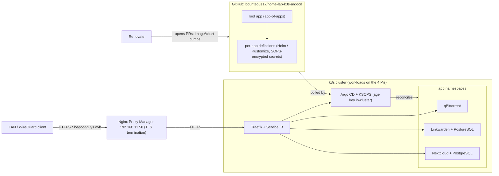

# home-lab-k3s-argocd

GitOps delivery of workloads to the home-lab k3s cluster with [Argo CD](https://argo-cd.readthedocs.io/).
This repository is the single source of truth for what runs on the cluster: Argo CD watches it and reconciles
the cluster to match.

> No secrets live in this repository. Secrets are committed only as SOPS-encrypted files; see [Secrets handling](#secrets-handling).

## Scope and ownership

This repo holds the desired state of the workloads. Everything else is owned elsewhere and linked, not duplicated.

| Topic | Owner |
|---|---|
| `<service>.begoodguys.ovh` catalog, CIDRs, hardware, general security | `home-lab-briefing` |
| The cluster itself: nodes, k3s config, bundled Traefik / ServiceLB / local-path, CNI, upgrades | `home-lab-k3s-ansible` |
| Nginx Proxy Manager (LXC, `192.168.11.50`) and its proxy hosts | `home-lab-proxmox-ansible` |
| Argo CD install and configuration, repo layout, sync policies, projects, per-app details, secrets approach, app-data backup/restore, how to add an app | **this repo** |

## Cluster at a glance

| Item | Value |
|---|---|
| Distribution | k3s v1.35 |
| Control plane | 1 VM (Arch Linux, 1 vCPU / 2 GiB), tainted `NoSchedule`: no workloads run on it |
| Agents | 4× Raspberry Pi 4B 4 GB (arm64): all workloads run here |
| Constraint | Every workload needs an **arm64 image** and must fit Pi resources |
| Access | Home-lab LAN and WireGuard clients only |

Heavy apps (Immich, Jellyfin) deliberately run as Proxmox LXCs, not on k3s, because Pi/VM compute is too small.
The taint, Traefik and ServiceLB are configured by [`home-lab-k3s-ansible`](https://github.com/bounteous17/home-lab-k3s-ansible).

## GitOps flow and request path

**Delivery:** Renovate (or a human) opens a PR; merging to `main` is the deploy. Argo CD picks up the commit, renders it (Helm/Kustomize, decrypting secrets with KSOPS) and applies it to the cluster.
**Request:** client → NPM (terminates TLS) → Traefik on the nodes → Service → Pod.

## Argo CD

| Aspect | Detail |
|---|---|
| Install | Argo CD runs in the `argocd` namespace. A one-time manual bootstrap installs it and applies the root app; from then on Argo CD manages itself through the root app |
| Hostname | `argocd.begoodguys.ovh`, reached through NPM like every other app |
| Pattern | App-of-apps: one root `Application` points at this repo and creates one child `Application` per workload |
| Projects | `infra` (Argo CD itself, shared components) and `apps` (user workloads), each restricted to this repo and its own namespaces |
| Sync policy | Automated sync with **prune** and **self-heal** enabled on every app, so the cluster always converges to Git |
| Rendering | Helm for upstream software; Kustomize for in-house glue; KSOPS for decrypting secrets |
| Login | GitHub SSO through the bundled Dex. The local `admin` account is disabled after bootstrap |

### Bootstrap (one time)

1. Install Argo CD from `bootstrap/` onto the cluster.
2. Create the SOPS age private key as a Secret in `argocd` out-of-band (never from Git) so KSOPS can decrypt.
3. Apply the root app; Argo CD then adopts itself and syncs every child app.
4. Log in via GitHub SSO and disable the local `admin` account.

## Repository layout

| Path | Purpose |
|---|---|
| `README.md` | This document |
| `bootstrap/` | One-time bootstrap: Argo CD install and the root app |
| `apps/` | One directory per workload (chart reference, values, encrypted secrets, extra resources) |
| `projects/` | Argo CD `AppProject` definitions |

## Apps on k3s

The public hostname catalog is maintained in `home-lab-briefing`; hostnames are repeated only to identify each app.

| App | Host | Source | Namespace | Persistence | Dependencies | arm64 |
|---|---|---|---|---|---|---|
| Argo CD | `argocd.begoodguys.ovh` | Official Argo CD Helm chart | `argocd` | None (state is Git) | none | Yes |
| qBittorrent | `qbittorrent.begoodguys.ovh` | LinuxServer.io arm64 image, Kustomize manifests | `qbittorrent` | Config volume; **downloads on the NFS storage** | none | Yes |
| Linkwarden | `linkwarden.begoodguys.ovh` | Upstream container image, Kustomize manifests | `linkwarden` | Archive/data volume | Dedicated PostgreSQL in its namespace | Yes |
| Nextcloud | `nextcloud.begoodguys.ovh` | Official Nextcloud Helm chart | `nextcloud` | Data volume | Dedicated PostgreSQL in its namespace | Yes |

### Resource requests

Requests are kept small so everything schedules on 4 GB Pis. Exact values live next to each app's definition in `apps/`.

| App | Sizing guidance |
|---|---|
| Argo CD | Single replicas, no HA |
| qBittorrent | Low CPU/RAM requests; memory limit set to avoid page-cache pressure on a Pi |
| Linkwarden | Moderate; its headless-browser archiving is the main spike |
| Nextcloud | The heaviest app; sized so it and its database fit comfortably on one Pi |

## Ingress and TLS

- Traefik and ServiceLB (bundled with k3s, owned by [`home-lab-k3s-ansible`](https://github.com/bounteous17/home-lab-k3s-ansible)) provide ingress; each app defines an ingress for its host.
- TLS is terminated at Nginx Proxy Manager (`home-lab-proxmox-ansible`), which forwards plain HTTP to the nodes.
- Hosts are reachable only from the home-lab LAN and WireGuard. See `home-lab-briefing` for the network and security model.

## Persistence

| Data | Storage |
|---|---|
| qBittorrent downloads | External NFS storage |
| Backups (restic repository, database dumps) | External NFS storage |
| Other app volumes (configs, Linkwarden archive, Nextcloud data, databases) | `local-path` (bundled with k3s), bound to the Pi a pod first lands on |

`local-path` volumes are node-local, so those stateful apps stay on their node; the backups below are what protect them.

## Secrets handling

- The repository is public: no plaintext secret is ever committed.
- Secrets are encrypted with **SOPS + age** and committed alongside the app that uses them.
- Argo CD decrypts them at render time through **KSOPS**. The age **private key is never in Git**; it lives only as a Secret in the `argocd` namespace, created at bootstrap, and in the operator's offline backup.
- Only the age public key is referenced by the repo's SOPS configuration.

## Image and chart updates

Renovate watches `apps/` and opens PRs for image and Helm chart version bumps. Merging a PR deploys it, since every app auto-syncs.

## Backup and restore of app data

| Data | Approach |
|---|---|
| Desired config | Git history; the cluster can be rebuilt from `bootstrap/` |
| Databases (Linkwarden, Nextcloud) | A CronJob per app runs `pg_dump` to the NFS storage |
| App volumes | A CronJob runs `restic` to copy the PVs to a repository on the NFS storage |
| Off-site | Roadmap: replicate the restic repository off-site |
| Restore | Rebuild the cluster (`home-lab-k3s-ansible`), bootstrap Argo CD, let it sync, then restore databases (`pg_restore`) and volumes (`restic restore`) into the fresh PVCs |

## Roadmap

- Argo CD notifications and monitoring.
- Off-site copy of the restic repository.

## Adding an app

1. Confirm the image supports **arm64** and fits Pi resources; otherwise run it as an LXC (see `home-lab-proxmox-ansible`).
2. Add a directory under `apps/<name>/` with the chart or manifests and values.
3. Reference it from the root app so a child `Application` is created in the correct project and namespace.
4. Encrypt any secrets with SOPS (age public key) and commit only the encrypted file.
5. If it has a database, give it its own PostgreSQL and add its `pg_dump` and restic CronJobs.
6. Merge to `main`; Argo CD syncs it.
7. Add the proxy host in NPM (`home-lab-proxmox-ansible`) and the hostname to the catalog in `home-lab-briefing`.
8. Add the app to the table in this README.
